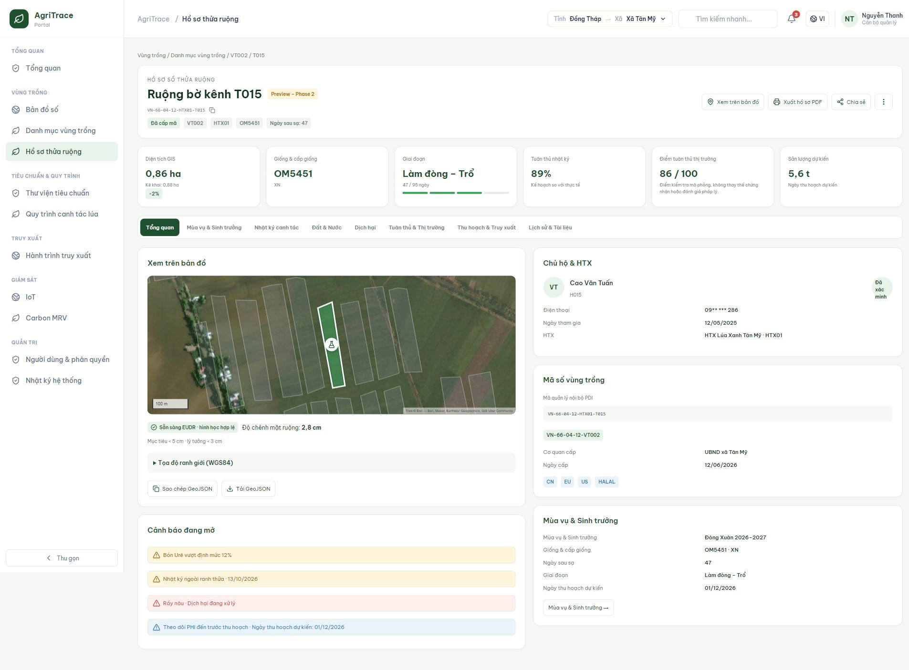
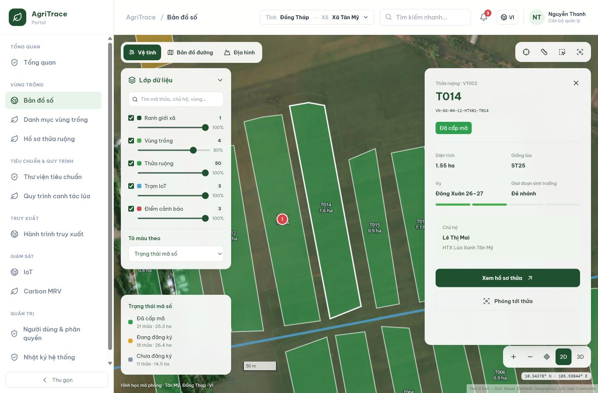

# AgriTrace Portal

Vietnamese/English demo portal for rice planting zones, parcel profiles, IoT monitoring and traceability. Built with React, TypeScript, Vite, Tailwind CSS, MapLibre GL JS, Turf and Recharts.

## Run locally

Requires Node.js 22 LTS or newer.

```sh
npm ci
npm run dev
```

## Validate and build

```sh
npm test
npm run typecheck:plots
npm run build
npm run preview
```

Production output is generated in `dist/`. Configure static hosting to serve `index.html` for client-side routes.

## Screens

- `/dashboard`: overview and satellite map preview.
- `/map`: real basemaps, seeded parcel geometry, filters, measurements, coordinates and plot drawer.
- `/zones`: planting-zone registry and member parcels.
- `/plots`: separate parcel list with owner/PDI search and filters.
- `/plots/VN-66-04-12-HTX01-T015`: showcase digital passport with eight tabs, logbook, GPS checks, soil/water, pests, compliance, harvest history and documents.
- `/iot`: sensor monitoring and station map.
- `/trace/plots/:pdi/:batch`: public demonstration batch traceability.

Other demo modules include farming, standards, carbon MRV and administration.

## Data and tiles

All agricultural, household, sensor and compliance records are mock data. Documents and photos are illustrative. Market checks and soil ranges are demonstration rules, not certification or legal determinations.

Basemaps require internet access and show provider attribution. Satellite uses Esri, terrain uses OpenTopoMap and street defaults to OpenStreetMap. To use CARTO Voyager, set `VITE_CARTO_API_KEY` in `.env.local` and rebuild. Local environment files are ignored by Git.

See [map notes](MAP_NOTES.md) and [plot profile notes](PLOT_PROFILE_NOTES.md) for implementation details.

## Previews




